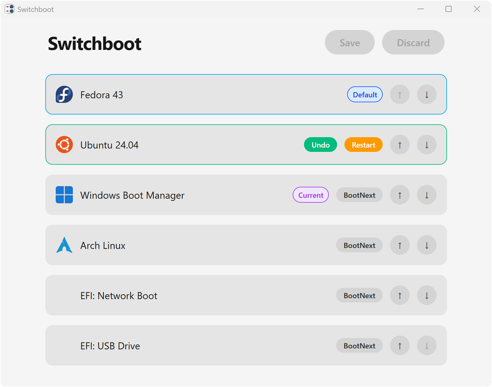

# Switchboot

[](https://github.com/moooozi/switchboot/releases/latest)
[](https://github.com/moooozi/switchboot/releases/latest)

Switchboot is an EFI boot entry manager for Windows and Linux.

<picture>
  <source media="(prefers-color-scheme: dark)" srcset="others/screenshot_switchboot_dark.png">
  
</picture>

## Features

- Edit and save the firmware boot order.
- Set a boot entry for the next restart without changing the default.
- Restart into UEFI firmware settings.
- Create desktop shortcuts for boot targets.

## Download and install

### Windows

The [Windows installer](https://github.com/moooozi/switchboot/releases/latest/download/Switchboot_x64-setup.exe) includes boot shortcuts and built-in updates.

The [portable version](https://github.com/moooozi/switchboot/releases/latest/download/Switchboot_x64-portable.exe) runs without installation and requests administrator permission on every start. Boot shortcuts and built-in updates require the installed version.

### Linux

Add the repository to install Switchboot and receive updates through your package manager.

#### Debian, Ubuntu and derivatives (APT)

Add the repository signing key and package source, then install:

```sh
sudo wget -qO /usr/share/keyrings/switchboot-archive-keyring.gpg \
  https://moooozi.github.io/switchboot/deb/switchboot-archive-keyring.gpg

echo "deb [signed-by=/usr/share/keyrings/switchboot-archive-keyring.gpg] https://moooozi.github.io/switchboot/deb stable main" | \
  sudo tee /etc/apt/sources.list.d/switchboot.list

sudo apt update
sudo apt install switchboot
```

#### Fedora 41+ (DNF5)

```sh
sudo dnf install dnf-plugins-core
sudo dnf config-manager addrepo --from-repofile=https://moooozi.github.io/switchboot/rpm/switchboot.repo
sudo dnf install switchboot
```

For older Fedora versions (DNF4), replace the repository-add command with:

```sh
sudo dnf config-manager --add-repo https://moooozi.github.io/switchboot/rpm/switchboot.repo
```

#### openSUSE and derivatives

```sh
sudo zypper addrepo https://moooozi.github.io/switchboot/rpm/switchboot.repo
sudo zypper refresh
sudo zypper install switchboot
```

#### Standalone packages

Alternatively, download a **DEB** or **RPM** package from the [latest release](https://github.com/moooozi/switchboot/releases/latest). Installing a standalone package does not configure the repository for future updates.

## Build from source

The app uses Rust and [iced](https://iced.rs/). Install a current stable Rust toolchain and Python 3.11+ for development scripts, then run:

```sh
git submodule update --init --recursive
python -m pip install --only-binary=:all: -r requirements-dev.txt
python scripts/generate_icons.py
cargo run -- --demo
```

Demo mode uses an in-memory backend. It does not access firmware, request administrator permission or restart the machine.

For real firmware access, run `cargo run`. Linux development builds also need polkit, a graphical authentication agent and a sibling CLI symlink:

```sh
cargo build
ln -sf switchboot target/debug/switchboot-cli
cargo run
```

## Bug reports and feature requests

Report bugs and request features in [GitHub issues](https://github.com/moooozi/switchboot/issues).
